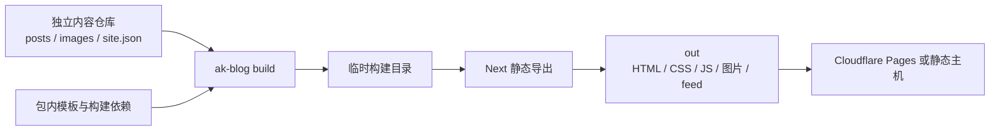

# 架构

模板包负责构建，内容仓库负责文章和站点配置，静态主机负责分发文件。Node 不参与线上请求处理。

## 包与内容的边界

`src/build/index.ts` 提供 `buildBlog({ contentDir, outDir, configFile? })`，编译为独立的 `@swufefox/ak-blog/build` 入口。它不依赖调用方的 Next.js 源码，也不在构建过程中安装软件包。

构建流程：

1. 校验输入目录、输出归属和 JSON 配置，拒绝覆盖源文件或无关的非空目录。
2. 复制包内当前模板到临时目录，移除示例内容，再放入调用方的 `posts/` 和 `images/`。
3. 通过 `src/site.override.json` 注入经过校验的 `site.json`，链接包声明并实际安装的构建依赖。
4. 在生产模式下执行真实的 `next build --webpack`；这也保证调用者的开发环境变量不能把草稿带进发布产物。
5. 构建成功后发布输出目录；失败保留原有输出。清理临时构建目录。

Webpack 用于让临时构建目录可靠解析包的实际依赖位置；不依赖 Turbopack 对临时目录之外符号链接的处理。源码开发仍可以使用 Next 的开发服务器。

`.ak-blog-output.json` 只标识输出由本工具生成，不写入内容仓库的绝对路径。内容目录不获得应用源码或 `node_modules`。

## 静态路由

页面数据与布局在 `src/views/` 中共享，`src/app/` 只保留实际路由入口和参数枚举。

| 地址 | 实现 |
| --- | --- |
| `/` | `src/app/(default)/page.tsx` → `src/views/home.tsx` |
| `/en` | `src/app/en/page.tsx` → 同一个首页实现 |
| `/posts/<slug>`、`/en/posts/<slug>` | 对应语言的静态参数 + `src/views/post.tsx` |
| `/tags`、`/en/tags` | `src/views/tags.tsx` |
| `/tags/<term>`、`/en/tags/<term>` | 静态词条参数 + `src/views/term.tsx` |
| `/search`、`/en/search` | `src/views/search.tsx` 与客户端过滤 |
| `/feed.xml`、`/en/feed.xml` | `force-static` GET + `src/views/feed.ts` |
| `/content/images/…` | 构建时枚举并导出允许的图片文件 |
| `/og.png` | 构建时生成 1200×630 PNG |
| `/sitemap.xml`、`/robots.txt` | 构建时生成 metadata 文件 |
| 未知地址 | 静态主机返回 `404.html` 和 HTTP 404 |

根路径和英文前缀是真实的静态路由，不通过运行时 rewrite，也不把导出的 `/zh` 文件重命名成根页面。`src/proxy.ts` 和动态 catch-all 已移除。Cloudflare 的旧 `/zh` 跳转由 `public/_redirects` 声明。

Next 16.4.6 静态导出会拒绝空的动态 `generateStaticParams()` 集合。`next.config.ts` 因此按实际内容启用公开的 `pageExtensions`：`zh-post.tsx`、`en-post.tsx`、`zh-term.tsx`、`en-term.tsx` 与 `images.ts`。对应入口形如 `page.zh-post.tsx` 或 `route.images.ts`；空集合直接不注册该动态路由，不制造假文章或假 URL。开发时全部扩展注册。

默认不启用 `trailingSlash`：`/en` 对应 `out/en.html`，文章对应 `out/posts/<slug>.html`。静态主机需支持 clean URLs。全局 `404.html` 使用默认中文外壳，语言切换链接直接返回英文首页；语言路由内部的 not-found 内容仍按语言渲染。

## 配置与 metadata

`src/site-options.ts` 定义内容仓库 JSON 契约；`src/site.config.ts` 合并模板默认值和 JSON 覆盖。`NEXT_PUBLIC_SITE_URL` 最后覆盖 origin。浏览器可导入站点配置，但配置模块不读取文件系统。

`src/views/layout.tsx` 提供共享 shell、主题 head 内容和 metadata 默认值。真正的 `<html>` / `<head>` / `<body>` 位于两套根 layout 和 `global-not-found.tsx`。默认中文文档使用 `zh-CN`，英文使用 `en`。

各内容页面显式提供 canonical 和语言链接，搜索 `noindex`，404 `noindex/nofollow`。`src/lib/social.ts` 统一引用 `/og.png`。给静态图片使用扩展名，使普通文件托管也能返回正确的 `image/png` 类型。

## 内容与 Markdown

`src/lib/posts.ts` 在构建时读取文件、解析 YAML、校验必填字段、过滤生产草稿、排序并推导分类、标签和翻译。集合在单个构建进程内缓存；每次包构建使用新的 Next 子进程，不跨内容仓库共享文章缓存。

`src/lib/markdown.ts` 保留统一管线顺序：

| 步骤 | 作用 |
| --- | --- |
| remark parse / GFM / math | Markdown、表格、任务列表与公式 |
| 原始 HTML 清理 | 丢弃作者直接写入的 HTML |
| 数学与自定义围栏 | KaTeX、data、stats、mermaid、sketch、echarts |
| remark → rehype / raw | 将管线生成的 HTML 转成节点 |
| slug 与目录 | h2/h3 锚点、TOC，排除自动链接符号 |
| 图片 metadata | 相对 URL、尺寸、lazy/async 属性 |
| Shiki 与代码包装 | 明暗代码主题、文件名、行号、复制按钮 |
| HTML 序列化 | 静态文章正文 |

`sketch` SVG 会清理，ECharts 只接受 JSON。非法 front matter 和 ECharts JSON 在构建时报出源文件上下文。

## 图片与浏览器行为

`src/lib/images.ts` 枚举 `content/images/` 中的普通图片文件，不跟随符号链接。图片 GET 使用完整静态参数与 `force-static`，只在构建期读取文件；产物由静态主机直接分发。正文仍保留 `/content/images/…` URL，源码不会成为公开路由。

交互留在小型客户端组件中：主题切换、菜单、搜索、目录 scrollspy、阅读进度和复制按钮。Mermaid 与 ECharts 仅在含相应图表的文章中动态加载。搜索在构建时得到本地化摘要，在浏览器按标题 4、标签/分类 2、摘要 1 计分，并把查询同步到 `?q=`。

ak-ui 的入口带有 `use client`，但组件仍在构建时产生首屏 HTML。`AkMobileMenu` 延迟到 hydration 后挂载，避免模块计数器 ID 差异。桌面目录使用 `AkHeading`，移动目录使用原生 `AkCollapsible`；关闭 JavaScript 后仍可展开目录。

## 打包与验证

`npm pack` 的 `prepack` 编译 UI、Node 构建 API和类型声明，再从当前源文件生成 `dist/template`。构建 API 的源码与维护脚本不会复制进独立模板。`ak-blog init` 是需要自定义源码时的显式入口；普通内容仓库只使用 `build`。

`scripts/smoke-package.mjs` 安装实际 tarball，构建独立双语和最小中文内容仓库，验证外部内容选择、站点配置、静态产物、草稿过滤、目录保护和构建失败后的输出保留。浏览器验证在普通静态文件服务器上进行，不能用 Next 服务端来掩盖导出缺陷。
